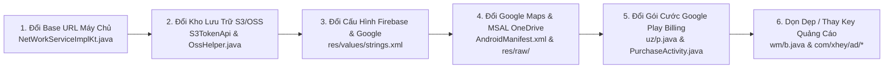

# 03. Danh Sách SDK, Thư Viện Bên Thứ Ba & Vị Trí Thay Thế Trong Mã Nguồn (Timemark Camera)

> **Đáp ứng Yêu cầu:** **Mục 5** (Danh sách tất cả các SDK và thư viện bên thứ 3 được nhúng trong ứng dụng, vai trò của từng cái và vị trí cần thay thế trong mã nguồn kèm bảng tổng quan).

---

## 1. Tổng Quan Kiến Trúc Phụ Thuộc (Dependency Landscape)

Qua phân tích 8 tệp DEX (`classes.dex` -> `classes8.dex`) và `AndroidManifest.xml`, ứng dụng **Timemark (`com.oceangalaxy.camera.new`)** tích hợp **52 SDK và thư viện bên thứ ba**, được chia thành 7 nhóm chức năng:
1. **Nhóm Quảng cáo & Kiếm tiền (Ad Mediation & Ad Networks)**: 14 SDK (chiếm tỷ trọng lớn nhất trong `classes2.dex` đến `classes6.dex`).
2. **Nhóm Phân tích, Attribution & Chẩn đoán lỗi (Analytics, MMP & Crash Reporting)**: 6 SDK.
3. **Nhóm Đám mây, Bản đồ & Định vị (Cloud Storage, Maps & Location)**: 5 SDK.
4. **Nhóm Đăng nhập & Thanh toán (Authentication & Billing)**: 5 SDK.
5. **Nhóm AI, Thị giác máy tính, Camera Vendor & Đa phương tiện (AI/CV, Camera & Media)**: 9 SDK.
6. **Nhóm Cross-Platform & Giao diện (React Native, UI & Document Processing)**: 7 SDK.
7. **Nhóm Core Networking & Cơ sở dữ liệu (Networking, Concurrency & Local Persistence)**: 6 SDK.

---

## 2. Bảng Tổng Hợp Toàn Bộ 52 SDK & Thư Viện Bên Thứ Ba (Mục 5)

| STT | Tên SDK / Thư viện | Phân nhóm | Package / Namespace trong `decompiled/sources/` | Vai trò trong ứng dụng | Vị trí cấu hình / Khởi tạo cần thay thế hoặc gỡ bỏ | Hành động khuyến nghị khi Rebuild |
| :---: | :--- | :--- | :--- | :--- | :--- | :--- |
| 1 | **Google AdMob / Google Mobile Ads SDK** | Quảng cáo | `com.google.android.gms.ads.*` | Mạng quảng cáo chính hiển thị Banner, Interstitial, Native và App Open Ads. | `AndroidManifest.xml` (`com.google.android.gms.ads.APPLICATION_ID`), `com/xhey/ad/*` | **Thay App ID & Ad Unit ID** của bạn hoặc gỡ bỏ nếu làm bản Enterprise sạch. |
| 2 | **TopOn / ThinkUp Mediation (`secmtp`)** | Quảng cáo | `com.secmtp.sdk.*`, `com.anythink.*` | Nền tảng điều phối quảng cáo trung gian (Ad Waterfall & Header Bidding). | `com/xhey/ad/tp/*`, `AndroidManifest.xml` (`com.secmtp.sdk.core.*`) | **Gỡ bỏ hoặc thay AppID/AppKey** trong lớp khởi tạo quảng cáo `com.xhey.ad`. |
| 3 | **SmartDigiMkt Mediation** | Quảng cáo | `com.smartdigimkt.sdk.*` | Lớp bọc điều phối quảng cáo đa mạng cho thị trường quốc tế. | `com/smartdigimkt/*`, `AndroidManifest.xml` | **Gỡ bỏ** nếu chuyển sang dùng thuần AdMob / AppLovin MAX. |
| 4 | **XHey First-Party AdX SDK** | Quảng cáo | `com.xhey.ad.*`, `wm.b` | SDK quảng cáo tự phát triển của XHey kết nối tới `adxapi.timemark.com`. | `sources/wm/b.java`, `TodayApiServiceKt.java` (`app/adx/global_fetch_exposure_config`) | **Vô hiệu hóa / Gỡ bỏ** hoàn toàn để tránh gọi về máy chủ quảng cáo của XHey. |
| 5 | **AppLovin MAX SDK** | Quảng cáo | `com.applovin.mediation.*`, `com.applovin.sdk.*` | Mạng quảng cáo và Mediation cạnh tranh giá thầu thời gian thực (In-App Bidding). | `AndroidManifest.xml` (`applovin.sdk.key`), `com/applovin/*` | **Thay SDK Key** trong `AndroidManifest.xml` hoặc gỡ bỏ. |
| 6 | **ByteDance Pangle SDK** | Quảng cáo | `com.bytedance.sdk.openadsdk.*` | Mạng quảng cáo video thưởng (Rewarded Video) và xen kẽ của TikTok/ByteDance. | `AndroidManifest.xml` (`TTMultiProvider`), `com/bytedance/sdk/*` | **Gỡ bỏ** hoặc thay App ID trên Pangle Dashboard. |
| 7 | **Bigo Ads SDK** | Quảng cáo | `sg.bigo.ads.*` | Mạng quảng cáo di động mạnh tại Đông Nam Á và Mỹ Latinh. | `AndroidManifest.xml` (`sg.bigo.ads.controller.provider.BigoAdsProvider`) | **Gỡ bỏ** nếu không dùng Bigo Ads. |
| 8 | **Mintegral (Mobvista) SDK** | Quảng cáo | `com.mbridge.msdk.*` | Mạng quảng cáo tự nhiên và video tương tác. | `AndroidManifest.xml` (`MBCommonActivity`), `com/mbridge/msdk/*` | **Gỡ bỏ** nếu không dùng Mintegral. |
| 9 | **Liftoff (Vungle) SDK** | Quảng cáo | `com.vungle.ads.*` | Mạng quảng cáo video toàn màn hình. | `AndroidManifest.xml` (`VungleProvider`), `com/vungle/ads/*` | **Gỡ bỏ** nếu không dùng Vungle. |
| 10 | **Unity Ads SDK** | Quảng cáo | `com.unity3d.services.ads.*`, `com.unity3d.ads.*` | Mạng quảng cáo video thưởng. | `AndroidManifest.xml` (`AdUnitActivity`), `com/unity3d/*` | **Gỡ bỏ** nếu không dùng Unity Ads. |
| 11 | **InMobi SDK** | Quảng cáo | `com.inmobi.ads.*`, `com.inmobi.sdk.*` | Mạng quảng cáo hiển thị và video. | `AndroidManifest.xml` (`InMobiAdActivity`), `com/inmobi/*` | **Gỡ bỏ** nếu không dùng InMobi. |
| 12 | **Moloco SDK** | Quảng cáo | `com.moloco.sdk.*` | Mạng quảng cáo lập trình (Programmatic DSP) dựa trên học máy. | `AndroidManifest.xml` (`MolocoAdActivity`), `com/moloco/sdk/*` | **Gỡ bỏ** nếu không dùng Moloco. |
| 13 | **QuMeng Overseas AdvLib** | Quảng cáo | `com.qumeng.overseas.advlib.*` | Thư viện quảng cáo phụ trợ của Trung Quốc bản hải ngoại. | `com/qumeng/overseas/advlib/*` | **Khuyến nghị gỡ bỏ hoàn toàn**. |
| 14 | **IAB Open Measurement SDK (OMSDK)** | Quảng cáo | `com.iab.omid.library.*` | Đo lường khả năng hiển thị quảng cáo (Viewability) theo chuẩn IAB. | Đi kèm bên trong các Ad SDK (`com/iab/omid/*`) | Tự động cập nhật theo AdMob / AppLovin. |
| 15 | **SensorsData Analytics (神策数据)** | Phân tích & Tracking | `com.sensorsdata.analytics.android.sdk.*` | **Hệ thống thu thập hành vi người dùng chi tiết nhất** trong app (tracking từng cú chạm, màn hình, phễu chuyển đổi). | `TodayApplication.java`, `com/xhey/xcamera/util/SensorAnalyzeUtil.java` | **Thay Server Receiving URL** sang máy chủ PostHog / Mixpanel / Firebase Analytics của bạn hoặc tắt hẳn. |
| 16 | **AppsFlyer SDK** | Attribution (MMP) | `com.appsflyer.*` | Đo lường nguồn cài đặt chiến dịch quảng cáo (Mobile Measurement Partner) và Deep Linking. | `TodayApplication.java`, `com/appsflyer/*` | **Thay AppsFlyer Dev Key** của bạn hoặc gỡ bỏ. |
| 17 | **Facebook App Events (Meta SDK)** | Attribution & Social | `com.facebook.appevents.*`, `com.facebook.share.*` | Theo dõi chuyển đổi quảng cáo Facebook/Instagram và chia sẻ ảnh lên Facebook. | `AndroidManifest.xml` (`com.facebook.sdk.ApplicationId`, `ClientToken`) | **Thay `facebook_app_id` & `facebook_client_token`** trong `res/values/strings.xml`. |
| 18 | **Firebase Analytics & Crashlytics & FCM** | Phân tích, Crash & Push | `com.google.firebase.analytics.*`, `com.google.firebase.crashlytics.*`, `com.google.firebase.messaging.*` | Theo dõi lỗi sập ứng dụng (Crashlytics), phân tích sự kiện và nhận thông báo đẩy (FCM). | `res/values/strings.xml` (`google_app_id`, `google_api_key`, `project_id`) | **Thay thế bằng tệp `google-services.json`** từ dự án Firebase mới của bạn. |
| 19 | **XCrash (iQiYi Native Crash)** | Chẩn đoán lỗi C++ | `xcrash.*` | Bắt lỗi sập ứng dụng ở tầng C/C++ (`SIGSEGV`, `SIGABRT`) và lỗi ANR (Application Not Responding). | `TodayApplication.java`, `xcrash/*` | **Giữ nguyên** và trỏ đường dẫn upload log về hệ thống của bạn (`Simple/upload/log`). |
| 20 | **ByteDance BPEA (Privacy Compliance)** | Kiểm soát quyền riêng tư | `com.bytedance.bpea.*` | Kiểm soát việc gọi API nhạy cảm (Vị trí, Clipboard, Camera) theo chính sách quyền riêng tư. | `com/bytedance/bpea/*` | Có thể giữ nguyên hoặc thay bằng trình quản lý quyền chuẩn của AndroidX. |
| 21 | **Google Maps SDK for Android** | Bản đồ & Định vị | `com.google.android.gms.maps.*` | Hiển thị bản đồ nhỏ (Mini-map) góc Watermark, bản đồ dự án Teamspace và vùng chấm công Geofence. | `AndroidManifest.xml` (`com.google.android.geo.API_KEY`) | **Thay thế `com.google.android.geo.API_KEY`** bằng Google Maps API Key của bạn. |
| 22 | **Google Play Services Location** | Bản đồ & Định vị | `com.google.android.gms.location.*` | Lấy tọa độ GPS chính xác (`FusedLocationProviderClient`) và kiểm tra trạng thái vị trí. | `com/xhey/xcamera/location/*` | **Giữ nguyên** (thư viện chuẩn của Google). |
| 23 | **Amazon AWS S3 SDK for Android** | Lưu trữ đám mây | `com.amazonaws.services.s3.*`, `com.amazonaws.auth.*` | Tải ảnh chụp, báo cáo công việc, log chẩn đoán và tệp `.mcap` lên kho lưu trữ Amazon S3. | `com/xhey/xcamera/oss/s3/*`, `S3TokenApi.java`, `OssHelper.java` | **Thay đổi Endpoint cấp STS Token** (`workgroup/v4/s3/token`) và tên Bucket S3 về tài khoản AWS/MinIO/Cloudflare R2 của bạn. |
| 24 | **Alibaba Cloud OSS SDK** | Lưu trữ đám mây | `com.alibaba.sdk.android.oss.*` | Tải tệp lên Alibaba Cloud Object Storage Service (dùng song song hoặc dự phòng cho S3). | `com/xhey/xcamera/oss/OSSApi.java`, `OssHelper.java` | Có thể giữ hoặc hợp nhất hoàn toàn về chuẩn S3-compatible (AWS S3 / Cloudflare R2 / MinIO). |
| 25 | **Tencent MMKV** | Lưu trữ nội bộ | `com.tencent.mmkv.*` | Lưu trữ Key-Value tốc độ cao bằng bộ nhớ ánh xạ (`mmap`), thay thế `SharedPreferences`. | `com/xhey/xcamera/data/pref/*` | **Giữ nguyên** (hiệu năng rất cao và ổn định). |
| 26 | **Google Play Billing Library v7** | Thanh toán | `com.android.billingclient.api.*`, `uz.p` | Xử lý mua gói thuê bao **Timemark Plus** (`subs`) và gói mua đứt 1 năm (`inapp`). | `sources/uz/p.java`, `PurchaseActivity.java` | **Thay danh sách Product ID / SKU** khớp với Google Play Console mới của bạn. |
| 27 | **Google Sign-In / Credentials Auth** | Đăng nhập | `com.google.android.gms.auth.api.*` | Đăng nhập một chạm bằng tài khoản Google. | `res/values/strings.xml` (`default_web_client_id`), `LoginActivity` | **Thay `default_web_client_id`** khớp với OAuth 2.0 Client ID trên Google Cloud của bạn. |
| 28 | **Microsoft Authentication Library (MSAL)** | Đăng nhập & Cloud | `com.microsoft.identity.client.*` | Đăng nhập bằng tài khoản doanh nghiệp Microsoft 365 và kết nối đồng bộ ảnh sang **OneDrive**. | `res/raw/auth_config_single_account.json`, `AndroidManifest.xml` (`BrowserTabActivity`) | **Thay `client_id` và `signature_hash`** trong `res/raw/auth_config_single_account.json` bằng Azure AD App của bạn. |
| 29 | **LINE SDK** | Chia sẻ & Đăng nhập | `com.linecorp.linesdk.*` | Chia sẻ ảnh/báo cáo qua ứng dụng LINE (phổ biến tại Thái Lan, Nhật Bản, Đài Loan). | `com/linecorp/linesdk/*` | Thay Channel ID hoặc gỡ bỏ nếu không phục vụ thị trường dùng LINE. |
| 30 | **SenseTime SenseME / SenseMARS SDK** | AI & Làm đẹp | `com.sensetime.stmobile.*` | Nhận diện điểm mốc khuôn mặt (Face Landmarks), làm đẹp da và hiệu ứng AR trên camera. | `assets/sensetime/SenseMARS_Effects-106-20270311-Android.lic`, `com/xhey/xcamerasdk/*` | File license hiện tại có hạn đến **11/03/2027**; khi đổi Package Name hoặc sau năm 2027 có thể thay bằng **Google MediaPipe Face Mesh + OpenGL LUTs** (đã có sẵn trong `assets/shaders/`). |
| 31 | **Tencent NCNN** | Edge AI Engine | Native `libnnpackage-f99779bd.so` | Framework suy luận mạng nơ-ron tốc độ cao trên di động (chạy Silero VAD, đếm thép, biển số). | `assets/nn/silerovad/*`, `com/xhey/xcamerasdk/algorithm/nn/*` | **Giữ nguyên** vì NCNN là mã nguồn mở miễn phí (BSD License), không khóa theo package name. |
| 32 | **Google MediaPipe** | Edge AI Engine | `com.google.mediapipe.*` / Native JNI | Nhận diện 21 khớp xương bàn tay (`HandLandmark`) và xử lý thị giác máy tính. | `com/xhey/xcamerasdk/algorithm/nn/HandLandmark.java` | **Giữ nguyên** (mã nguồn mở Apache 2.0 của Google). |
| 33 | **Google ML Kit / Play Services Vision** | OCR & Barcode | `com.google.mlkit.*`, `com.google.android.gms.vision.*` | Quét mã QR/Barcode trên công trường và nhận diện văn bản phụ trợ. | `com/xhey/xcamera/ui/watermark/qrcode/*` | **Giữ nguyên** (hoạt động miễn phí trên thiết bị). |
| 34 | **CameraX (Jetpack Camera)** | Phần cứng Camera | `androidx.camera.core.*`, `androidx.camera.camera2.*`, `androidx.camera.lifecycle.*` | Quản lý vòng đời Camera hiện đại, kết hợp với Camera2 API. | `com/xhey/xcamerasdk/product/camerax/*` | **Giữ nguyên** làm trục chính cho Camera. |
| 35 | **Huawei CameraKit / Xiaomi MiCamera / Oppo-Vivo Camera Extensions** | Phần cứng Camera | `com.huawei.camera.camerakit.*`, `com.xiaomi.camera.*`, `com.oplus.ocs.camera.*` | Tối ưu hóa chống rung, HDR và góc siêu rộng (Ultra-Wide) riêng cho các dòng máy Trung Quốc. | `com/xhey/xcamerasdk/product/*` | **Giữ nguyên** (tự động fallback về CameraX/Camera2 nếu thiết bị không hỗ trợ). |
| 36 | **ExoPlayer (Media3)** | Đa phương tiện | `com.google.android.exoplayer2.*` | Phát video hướng dẫn nhiệm vụ Earn, xem lại video có đóng dấu Watermark. | `com/xhey/xcamera/player/*`, `com/xhey/xcamera/earn/*` | **Giữ nguyên**. |
| 37 | **React Native (0.7x + Hermes Engine)** | Cross-Platform UI | `com.facebook.react.*`, `com.facebook.hermes.*`, `com.swmansion.reanimated.*`, `com.horcrux.svg.*` | Chạy các màn hình viết bằng React Native (`VerifyAuth` xác thực ảnh và `Questionnaire` khảo sát). | `com/xhey/xcamera/rn/*`, `assets/*.bundle`, `assets/*.jsbundle` | Có thể **giữ nguyên** hoặc chuyển 2 màn hình này sang Native Kotlin/Compose để giảm ~15 MB dung lượng APK. |
| 38 | **Apache POI (Excel & Word Generator)** | Xử lý Tài liệu | `org.apache.poi.ss.*`, `org.apache.poi.xssf.*` | Tạo và xuất báo cáo bảng chấm công, danh sách ảnh nghiệm thu ra file **Excel (`.xlsx`)** trực tiếp trên điện thoại. | `org/apache/poi/*`, `com/xhey/xcamera/ui/localpreview/*` | **Giữ nguyên** (tính năng cực kỳ giá trị cho người dùng doanh nghiệp/xây dựng). |
| 39 | **BouncyCastle Crypto (`org.bouncycastle`)** | Mật mã học | `org.bouncycastle.*` | Cung cấp các thuật toán mã hóa, băm và chữ ký số phục vụ xác thực. | `org/bouncycastle/*` | **Giữ nguyên**. |
| 40 | **Glide v4** | Tải & Cache Ảnh | `com.bumptech.glide.*` | Tải, giải mã và lưu đệm hình ảnh, khung Watermark, ảnh đại diện nhóm. | `com/bumptech/glide/*` | **Giữ nguyên**. |
| 41 | **Lottie Android (Airbnb)** | Hoạt ảnh Vector | `com.airbnb.lottie.*` | Hiển thị các hiệu ứng hoạt ảnh JSON mượt mà (`assets/*.json`). | `com/airbnb/lottie/*` | **Giữ nguyên**. |
| 42 | **ZXing (Zebra Crossing)** | Tạo & Quét Mã QR | `com.google.zxing.*` | Sinh mã QR dẫn tới liên kết nhóm Teamspace, mã QR danh thiếp/vị trí in прямо lên Watermark. | `com/google/zxing/*`, `com/xhey/xcamera/ui/watermark/qrcode/*` | **Giữ nguyên**. |
| 43 | **ImmersionBar (`gyf.immersionbar`)** | Giao diện Hệ thống | `com.gyf.immersionbar.*` | Quản lý thanh trạng thái (Status Bar) và thanh điều hướng trong suốt toàn màn hình. | `com/gyf/immersionbar/*`, `BaseActivity` | **Giữ nguyên** hoặc dùng `WindowCompat.setDecorFitsSystemWindows` của AndroidX. |
| 44 | **BaseRecyclerViewAdapterHelper (BRVAH)** | Giao diện Danh sách | `com.chad.library.adapter.*` | Tăng tốc xây dựng các danh sách phức tạp (kho mẫu Watermark, danh sách ảnh nhóm). | `com/chad/library/adapter/*` | **Giữ nguyên**. |
| 45 | **SmartRefreshLayout (`scwang.smart`)** | Giao diện Kéo-Làm-Mới | `com.scwang.smart.refresh.layout.*` | Hiệu ứng kéo xuống để làm mới (Pull-to-Refresh) và tải thêm trang (Load More). | `com/scwang/smart/refresh/*` | **Giữ nguyên**. |
| 46 | **PictureSelector (`luck.picture.lib`)** | Bộ chọn Ảnh/Video | `com.luck.picture.lib.*` | Giao diện chọn nhiều ảnh/video từ thư viện thiết bị để đóng dấu hàng loạt hoặc tải lên nhóm. | `com/luck/picture/lib/*` | **Giữ nguyên**. |
| 47 | **EventBus / LiveEventBus** | Giao tiếp Nội bộ | `org.greenrobot.eventbus.*`, `com.jeremyliao.liveeventbus.*` | Truyền thông điệp sự kiện giữa các Activity, Fragment và Service nền. | `org/greenrobot/eventbus/*`, `com/jeremyliao/liveeventbus/*` | **Giữ nguyên**. |
| 48 | **Retrofit2 + OkHttp3** | Giao tiếp Mạng | `retrofit2.*` (`pm0.*`), `okhttp3.*` (`jg0.*`) | HTTP Client và REST API khai báo qua Annotation cho 177 endpoints. | `com/xhey/xcamera/network/service/NetWorkServiceImplKt.java` | **Giữ nguyên**, chỉ cần đổi Base URL trong `NetWorkServiceImplKt`. |
| 49 | **Chromium Cronet Engine** | Tăng tốc Mạng (QUIC/HTTP3) | `org.chromium.net.*` | Giao thức mạng QUIC / HTTP/3 của Google giúp tăng tốc tải ảnh/video trong điều kiện sóng 3G/4G yếu tại công trường. | `org/chromium/net/*`, `NetWorkServiceImplKt.java` | **Giữ nguyên** (rất hữu ích khi chụp ảnh ở vùng sâu vùng xa). |
| 50 | **Google Gson & Protobuf Java** | Tuần tự hóa Dữ liệu | `com.google.gson.*`, `com.google.protobuf.*` | Chuyển đổi JSON <-> Kotlin/Java Objects và đóng gói dữ liệu nhị phân Protobuf (cho `.mcap`). | Toàn bộ tầng `data/model/bean/*` & `mcap/*` | **Giữ nguyên**. |
| 51 | **Jetpack Room ORM (v2.6)** | Cơ sở dữ liệu SQLite | `androidx.room.*` (`q8.*`), `com.xhey.xcamera.room.*` | Quản lý cơ sở dữ liệu nội bộ `TodayCameraDB` gồm 42 bảng. | `com/xhey/xcamera/room/TodayCameraDB_Impl.java` | **Giữ nguyên** 100% schema. |
| 52 | **RxJava2 / RxAndroid & Kotlin Coroutines** | Xử lý Bất đồng bộ | `io.reactivex.*` (`dd0.*`), `kotlinx.coroutines.*` (`cf0.*`) | Quản lý luồng nền (Background Threads), xử lý ảnh và gọi API. | Toàn bộ ứng dụng | **Giữ nguyên**. |

---

## 3. Hướng Dẫn Chi Tiết Các Điểm Cần Thay Thế Khi Chuyển Đổi Sang Hệ Thống Mới (Migration Checklist)

Khi tái xây dựng hoặc tùy biến ứng dụng sang thương hiệu và máy chủ riêng, kỹ sư chỉ cần can thiệp vào **6 điểm chốt chặn (Choke Points)** sau đây trong mã nguồn:

1. **Chốt chặn 1 — Thay thế Máy chủ Backend (`NetWorkServiceImplKt.java`)**:
   - Mở tệp `decompiled/sources/com/xhey/xcamera/network/service/NetWorkServiceImplKt.java`.
   - Tại các hàm `getProductEnvUrl()`, `getStagingUrl()`, `getTestUrl()`, thay thế chuỗi `"https://app.timemark.com/next/"` bằng địa chỉ API Gateway mới của bạn.
2. **Chốt chặn 2 — Thay thế Kho lưu trữ đám mây AWS S3 / Alibaba OSS (`OssHelper.java`)**:
   - Mở `decompiled/sources/com/xhey/xcamera/oss/OssHelper.java` và `S3TokenApi.java`.
   - Cấu hình API `/next/workgroup/v4/s3/token` trên Backend của bạn trả về STS Credentials trỏ tới Bucket AWS S3 / Cloudflare R2 / MinIO của bạn.
3. **Chốt chặn 3 — Thay thế Cấu hình Firebase, Google Sign-In & Facebook (`res/values/strings.xml`)**:
   - Thay thế các khóa trong `decompiled/resources/res/values/strings.xml`:
     - `google_app_id`, `google_api_key`, `gcm_defaultSenderId`, `project_id`, `default_web_client_id`.
     - `facebook_app_id`, `facebook_client_token`.
4. **Chốt chặn 4 — Thay thế Khóa Bản đồ Google Maps & Microsoft OneDrive (`AndroidManifest.xml` & `res/raw/auth_config_single_account.json`)**:
   - Trong `AndroidManifest.xml`: cập nhật `<meta-data android:name="com.google.android.geo.API_KEY" android:value="..." />`.
   - Trong `res/raw/auth_config_single_account.json`: cập nhật `client_id` và `redirect_uri` (chứa chữ ký SHA-1 của keystore mới) nếu muốn dùng tính năng tự động đồng bộ ảnh lên Microsoft OneDrive.
5. **Chốt chặn 5 — Thay thế Danh sách SKU Thanh toán (`uz/p.java` & `PurchaseActivity.java`)**:
   - Cập nhật mã sản phẩm mặc định (`plus_1year_onetime`, `00000001`, `0000000220240807`, `pro-monthly-non-stripe`) trong `decompiled/sources/uz/p.java` hoặc điều khiển động 100% thông qua API `POST /next/goods/query`.
6. **Chốt chặn 6 — Gỡ bỏ Tracking Trung Quốc & Thay Key Quảng cáo (`SensorAnalyzeUtil.java`, `wm/b.java`)**:
   - Vô hiệu hóa gửi dữ liệu về **SensorsData (`com.sensorsdata.analytics`)** và **QuMeng (`com.qumeng.overseas.advlib`)** để tối ưu hiệu năng mạng và đảm bảo toàn quyền kiểm soát dữ liệu người dùng.
