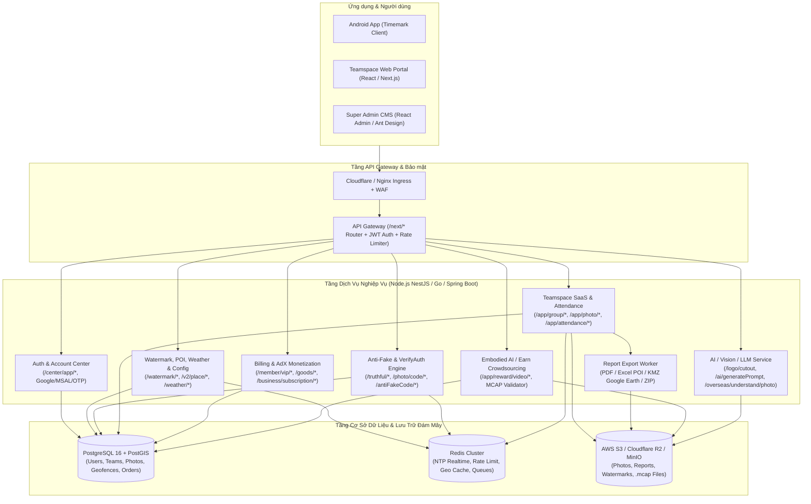

# 06. Blueprint Thiết Kế Backend, Hệ Thống Quản Trị CMS & Toàn Bộ 42 Bảng Cơ Sở Dữ Liệu (`TodayCameraDB`)

> **Đáp ứng Yêu cầu:** **Mục 13** (Phân tích và lên phương án xây dựng lại Backend, CMS và cấu trúc bảng Database 100% khớp với ứng dụng hiện tại).

---

## 1. Cấu Trúc Cơ Sở Dữ Liệu Nội Bộ 100% Chính Xác (`TodayCameraDB` - Version 61, 42 Bảng)

Toàn bộ cấu trúc 42 bảng dưới đây được trích xuất **chính xác 100% từng tên bảng, tên cột, kiểu dữ liệu, khóa chính và chỉ mục (Index)** từ tệp `decompiled/sources/com/xhey/xcamera/room/TodayCameraDB_Impl.java` (Identity Hash: `42c2d7ad2a08151fd235f16b87d1a965`).

> **Tệp thực thi đi kèm**: Toàn bộ lệnh `CREATE TABLE`, `CREATE INDEX`, dữ liệu mẫu `INSERT` và cơ sở dữ liệu SQLite thực tế đã được đóng gói tại:
> - [Demo Data/timemark.db](file:///E:/Decompiler/APP/IMAGE/Timemark/Demo%20Data/timemark.db)
> - [Demo Data/database_schema_and_queries.sql](file:///E:/Decompiler/APP/IMAGE/Timemark/Demo%20Data/database_schema_and_queries.sql)

### 1.1. Sơ Đồ Quan Hệ Thực Thể Tổng Quan (ERD - Core Entities)

```mermaid
erDiagram
    TEAM_SPACE_ENTRY ||--o{ PROJECT_ITEM_TABLE : "chứa các dự án"
    TEAM_SPACE_ENTRY ||--o{ TEAM_WATERMARK_TEMPLATE : "quy định mẫu watermark"
    TEAM_SPACE_ENTRY ||--o{ CHECKLIST_TEMPLATE : "quản lý checklist"
    PROJECT_ITEM_TABLE ||--o{ UPLOAD_PROGRESS_TASK_ENTRY : "đồng bộ ảnh/video"
    PROJECT_ITEM_TABLE ||--o{ DOC_UPLOAD_TASK_ENTRY : "lưu tài liệu dự án"
    CHECKLIST_TEMPLATE ||--o{ CHECKLIST_SUBMISSION : "nhận bài nộp nghiệm thu"
    CLOUD_CATEGORY_TABLE ||--o{ CLOUD_WATER_MARK_TABLE : "phân loại kho mẫu"
    NEW_WATERMARKS_TABLE ||--o{ USE_RECENT_WATER_MARK_TABLE : "ghi nhận sử dụng gần đây"
    NEW_WATERMARKS_TABLE ||--o{ RECENTLY_EDITED_TABLE : "lưu lịch sử chỉnh sửa"
    STAND_ALONE_PHOTO_TABLE ||--o| PHOTO_CODE_ENTITY : "gắn mã xác thực PhotoCode"
    STAND_ALONE_PHOTO_TABLE ||--o| PICTURE_UP_TABLE : "đẩy lên S3/OSS"
    WORK_GROUP_TABLE ||--o{ WORK_GROUP_PICTURE_TABLE : "lưu ảnh nhóm"
    WORK_GROUP_TABLE ||--o{ WORK_GROUP_WATER_MARK_TABLE : "mẫu watermark nhóm"
    PATROL_TABLE ||--o{ PATROL_TASK_TABLE : "gồm các điểm tuần tra"
```

---

### 1.2. Danh Mục Chi Tiết Toàn Bộ 42 Bảng Trong `TodayCameraDB`

#### Nhóm A: Quản Lý Mẫu Watermark & Kho Giao Diện (8 Bảng)

| STT | Tên Bảng (`TableName`) | Khóa Chính (`PK`) | Danh Sách Các Cột & Kiểu Dữ Liệu (SQLite/Room) | Vai Trò Nghiệp Vụ |
| :---: | :--- | :--- | :--- | :--- |
| 1 | `new_watermarks_table` | `id` (`TEXT`) | `id` TEXT NOT NULL, `name` TEXT, `base_id` TEXT, `category_id` TEXT, `type` INTEGER NOT NULL, `update_time` TEXT, `version` TEXT, `water_mark_content` TEXT (JSON cấu hình chi tiết), `is_pgc` INTEGER NOT NULL, `pgc_Order` INTEGER NOT NULL | Bảng trung tâm lưu trữ tất cả mẫu Watermark đang cài đặt trên máy người dùng. |
| 2 | `cloud_water_mark_table` | `id` (`TEXT`) | `id` TEXT NOT NULL, `name` TEXT, `base_id` TEXT, `category_id` TEXT, `type` INTEGER NOT NULL, `update_time` TEXT, `version` TEXT, `cover_image_url` TEXT, `water_mark_content` TEXT, `vip_type` INTEGER NOT NULL | Lưu đệm danh sách mẫu Watermark tải từ kho đám mây (`watermark/ours/query`, `watermark/pgc/query`). |
| 3 | `share_water_mark_table` | `id` (`TEXT`) | `id` TEXT NOT NULL, `name` TEXT, `base_id` TEXT, `category_id` TEXT, `type` INTEGER NOT NULL, `update_time` TEXT, `version` TEXT, `cover_image_url` TEXT, `water_mark_content` TEXT, `share_code` TEXT | Lưu các mẫu Watermark được chia sẻ qua mã code (`share_code`) hoặc liên kết UGC. |
| 4 | `cloud_category_table` | `id` (`TEXT`) | `id` TEXT NOT NULL, `name` TEXT, `icon_url` TEXT, `sort_order` INTEGER NOT NULL, `status` INTEGER NOT NULL | Danh mục ngành nghề của kho mẫu Watermark (Xây dựng, An ninh, Giao hàng, Vệ sinh...). |
| 5 | `use_recent_water_mark_table` | `id` (`TEXT`) | `id` TEXT NOT NULL, `base_id` TEXT, `update_time` INTEGER NOT NULL, `use_count` INTEGER NOT NULL, `from_type` INTEGER NOT NULL | Theo dõi các mẫu Watermark người dùng vừa sử dụng gần đây để đưa lên đầu danh sách. |
| 6 | `recently_edited_table` | `id` (`TEXT`) | `id` TEXT NOT NULL, `base_id` TEXT, `watermark_id` TEXT, `item_id` INTEGER NOT NULL, `content` TEXT, `edit_time` INTEGER NOT NULL | Lưu lịch sử các trường văn bản vừa chỉnh sửa trên Watermark để gợi ý nhập nhanh. |
| 7 | `watermark_template_edit_guide_table` | `id` (`TEXT`) | `id` TEXT NOT NULL, `shown_count` INTEGER NOT NULL, `last_shown_time` INTEGER NOT NULL | Kiểm soát số lần hiển thị bong bóng hướng dẫn chỉnh sửa trên từng mẫu Watermark. |
| 8 | `history_grouping_table` | `id` (`INTEGER` Auto) | `id` INTEGER PK AUTOINCREMENT, `watermark_id` TEXT, `base_id` TEXT, `item_id` INTEGER NOT NULL, `group_name` TEXT, `item_content` TEXT, `update_time` INTEGER NOT NULL | Lưu các nhóm nội dung ghi chú lịch sử theo từng trường (`item_id`) của mẫu Watermark. |

#### Nhóm B: Ảnh Chụp, Chấm Công Cá Nhân, Mã Chống Giả & Đồng Bộ Đám Mây (7 Bảng)

| STT | Tên Bảng (`TableName`) | Khóa Chính (`PK`) | Danh Sách Các Cột & Kiểu Dữ Liệu (SQLite/Room) | Vai Trò Nghiệp Vụ |
| :---: | :--- | :--- | :--- | :--- |
| 9 | `stand_alone_photo_table` | `path` (`TEXT`) | `path` TEXT NOT NULL, `time` INTEGER NOT NULL, `lat` REAL NOT NULL, `lng` REAL NOT NULL, `address` TEXT, `watermark_id` TEXT, `base_id` TEXT, `media_type` INTEGER NOT NULL, `photo_code` TEXT, `synced` INTEGER NOT NULL | Lưu danh sách toàn bộ ảnh/video chụp ở chế độ cá nhân kèm tọa độ, mã chống giả và trạng thái đồng bộ. |
| 10 | `picture_up_table` | `id` (`INTEGER` Auto) | `id` INTEGER PK AUTOINCREMENT, `local_file_path` TEXT, `oss_file_path` TEXT, `upload_status` INTEGER NOT NULL, `take_photo_time` INTEGER NOT NULL, `lat` REAL NOT NULL, `lng` REAL NOT NULL, `location_address` TEXT, `watermark_base_id` TEXT, `watermark_id` TEXT, `photo_info_json` TEXT, `retry_count` INTEGER NOT NULL, `media_type` INTEGER NOT NULL | Hàng đợi tải ảnh/video lên đám mây S3/OSS (hỗ trợ chụp Offline và tự động tải lên khi có mạng). |
| 11 | `album_number_table_new` | `id` (`INTEGER` Auto) | `id` INTEGER PK AUTOINCREMENT, `take_date` TEXT, `photo_num` INTEGER NOT NULL, `video_num` INTEGER NOT NULL, `watermark_id` TEXT | Thống kê số lượng ảnh và video chụp theo từng ngày và từng mẫu Watermark. |
| 12 | `water_check_in_take_history_table` | `id` (`INTEGER` Auto) | `id` INTEGER PK AUTOINCREMENT, `take_time` INTEGER NOT NULL, `date_str` TEXT, `month_str` TEXT, `lat` REAL NOT NULL, `lng` REAL NOT NULL, `address` TEXT, `photo_path` TEXT, `watermark_id` TEXT, `shift_type` INTEGER NOT NULL, `remark` TEXT | Lưu lịch sử chấm công cá nhân (Giờ vào ca, tan ca, tọa độ, đường dẫn ảnh minh chứng). |
| 13 | `photo_code_entity` | `photo_code` (`TEXT`) | `photo_code` TEXT NOT NULL, `local_path` TEXT, `oss_url` TEXT, `capture_time` INTEGER NOT NULL, `lat` REAL NOT NULL, `lng` REAL NOT NULL, `address` TEXT, `watermark_json` TEXT, `verify_status` INTEGER NOT NULL, `created_at` INTEGER NOT NULL | Lưu siêu dữ liệu xác thực của từng mã `PhotoCode` in trên ảnh để tra cứu chống giả mạo. |
| 14 | `anti_code_entry` | `code` (`TEXT`) | `code` TEXT NOT NULL, `status` INTEGER NOT NULL, `create_time` INTEGER NOT NULL, `use_time` INTEGER NOT NULL, `photo_path` TEXT, `extra_json` TEXT | Kho lưu trữ các mã chống giả (`antiFakeCode`) được sinh trước để cấp phát ngay cả khi chụp ảnh không có Internet. |
| 15 | `oss_data_table` | `id` (`TEXT`) | `id` TEXT NOT NULL, `access_key_id` TEXT, `access_key_secret` TEXT, `security_token` TEXT, `expiration` INTEGER NOT NULL, `bucket_name` TEXT, `endpoint` TEXT, `region` TEXT | Lưu đệm thông tin chứng chỉ STS Token tạm thời của AWS S3 / Alibaba OSS. |

#### Nhóm C: Định Vị GPS, Địa Điểm POI & Bản Đồ Ngoại Tuyến (5 Bảng)

| STT | Tên Bảng (`TableName`) | Khóa Chính (`PK`) | Danh Sách Các Cột & Kiểu Dữ Liệu (SQLite/Room) | Vai Trò Nghiệp Vụ |
| :---: | :--- | :--- | :--- | :--- |
| 16 | `place_list_entity` | `place_id` (`TEXT`) | `place_id` TEXT NOT NULL, `name` TEXT, `address` TEXT, `lat` REAL NOT NULL, `lng` REAL NOT NULL, `distance` REAL NOT NULL, `type_code` TEXT, `city` TEXT, `district` TEXT, `update_time` INTEGER NOT NULL | Lưu đệm danh sách địa điểm xung quanh vị trí hiện tại để hiển thị tức thì khi mở Camera. |
| 17 | `search_place_entity` | `id` (`INTEGER` Auto) | `id` INTEGER PK AUTOINCREMENT, `keyword` TEXT, `place_id` TEXT, `name` TEXT, `address` TEXT, `lat` REAL NOT NULL, `lng` REAL NOT NULL, `search_time` INTEGER NOT NULL | Lưu lịch sử tìm kiếm địa điểm POI của người dùng. |
| 18 | `prefer_place_entity` | `place_id` (`TEXT`) | `place_id` TEXT NOT NULL, `name` TEXT, `address` TEXT, `lat` REAL NOT NULL, `lng` REAL NOT NULL, `use_count` INTEGER NOT NULL, `last_use_time` INTEGER NOT NULL, `custom_alias` TEXT | Lưu các địa điểm người dùng thường xuyên chọn hoặc đánh dấu yêu thích (Favorite Addresses). |
| 19 | `custom_poi_table` | `id` (`INTEGER` Auto) | `id` INTEGER PK AUTOINCREMENT, `poi_name` TEXT, `address` TEXT, `lat` REAL NOT NULL, `lng` REAL NOT NULL, `create_time` INTEGER NOT NULL, `group_id` TEXT | Lưu các địa điểm tùy chỉnh do người dùng tự tạo tại các công trường chưa có trên bản đồ Google Maps. |
| 20 | `lat_long_poi_entity` | `grid_key` (`TEXT`) | `grid_key` TEXT NOT NULL, `lat` REAL NOT NULL, `lng` REAL NOT NULL, `poi_list_json` TEXT, `weather_json` TEXT, `cache_time` INTEGER NOT NULL | Lưu đệm kết quả Reverse Geocoding và Thời tiết theo ô lưới tọa độ (`grid_key`) giúp chụp ảnh Offline vẫn có tên đường! |

#### Nhóm D: Hệ Sinh Thái Teamspace SaaS, Dự Án, Checklist & Tuần Tra (8 Bảng)

| STT | Tên Bảng (`TableName`) | Khóa Chính (`PK`) | Danh Sách Các Cột & Kiểu Dữ Liệu (SQLite/Room) | Vai Trò Nghiệp Vụ |
| :---: | :--- | :--- | :--- | :--- |
| 21 | `team_space_entry` | `team_id` (`TEXT`) | `team_id` TEXT NOT NULL, `team_name` TEXT, `role` INTEGER NOT NULL, `member_count` INTEGER NOT NULL, `photo_count` INTEGER NOT NULL, `plan_type` INTEGER NOT NULL, `storage_used_bytes` INTEGER NOT NULL, `storage_limit_bytes` INTEGER NOT NULL, `avatar_url` TEXT, `settings_json` TEXT, `updated_at` INTEGER NOT NULL | Lưu thông tin các không gian làm việc nhóm (Teamspace), gói cước Business và hạn mức dung lượng. |
| 22 | `team_watermark_template` | `template_id` (`TEXT`) | `template_id` TEXT NOT NULL, `team_id` TEXT NOT NULL, `project_id` TEXT, `name` TEXT, `base_id` TEXT, `content_json` TEXT, `force_apply` INTEGER NOT NULL, `lock_time_location` INTEGER NOT NULL, `sort_order` INTEGER NOT NULL, `updated_at` INTEGER NOT NULL | Lưu các mẫu Watermark chuẩn của nhóm/dự án và cờ khóa chỉnh sửa giờ/tọa độ (`lock_time_location`). |
| 23 | `upload_progress_task_entry` | `task_id` (`TEXT`) | `task_id` TEXT NOT NULL, `team_id` TEXT NOT NULL, `project_id` TEXT, `local_path` TEXT NOT NULL, `remote_url` TEXT, `media_type` INTEGER NOT NULL, `file_size` INTEGER NOT NULL, `uploaded_bytes` INTEGER NOT NULL, `status` INTEGER NOT NULL, `error_msg` TEXT, `meta_json` TEXT, `created_at` INTEGER NOT NULL | Quản lý tiến trình tải ảnh/video dung lượng lớn lên kho đám mây Teamspace (hỗ trợ Resume khi đứt mạng). |
| 24 | `doc_upload_task_entry` | `doc_id` (`TEXT`) | `doc_id` TEXT NOT NULL, `team_id` TEXT NOT NULL, `project_id` TEXT NOT NULL, `file_name` TEXT, `local_path` TEXT, `remote_url` TEXT, `mime_type` TEXT, `file_size` INTEGER NOT NULL, `status` INTEGER NOT NULL, `created_at` INTEGER NOT NULL | Quản lý tải các tệp tài liệu dự án (PDF, CAD, Excel, Word) lên Teamspace. |
| 25 | `checklist_template` | `checklist_id` (`TEXT`) | `checklist_id` TEXT NOT NULL, `team_id` TEXT NOT NULL, `project_id` TEXT, `title` TEXT, `description` TEXT, `items_json` TEXT, `require_photo` INTEGER NOT NULL, `status` INTEGER NOT NULL, `updated_at` INTEGER NOT NULL | Lưu mẫu danh mục kiểm tra nghiệm thu hiện trường (Checklist Template). |
| 26 | `checklist_submission` | `submission_id` (`TEXT`) | `submission_id` TEXT NOT NULL, `checklist_id` TEXT NOT NULL, `team_id` TEXT NOT NULL, `project_id` TEXT, `user_id` TEXT, `answers_json` TEXT, `photo_urls_json` TEXT, `status` INTEGER NOT NULL, `submitted_at` INTEGER NOT NULL | Lưu bài nộp kết quả kiểm tra Checklist kèm danh sách ảnh nghiệm thu của nhân viên. |
| 27 | `patrol_table` | `patrol_id` (`TEXT`) | `patrol_id` TEXT NOT NULL, `route_name` TEXT, `group_id` TEXT, `total_points` INTEGER NOT NULL, `completed_points` INTEGER NOT NULL, `start_time` INTEGER NOT NULL, `end_time` INTEGER NOT NULL, `status` INTEGER NOT NULL | Quản lý ca tuần tra bảo vệ / kiểm tra an ninh tòa nhà theo tuyến (`route_name`). |
| 28 | `patrol_task_table` | `task_id` (`TEXT`) | `task_id` TEXT NOT NULL, `patrol_id` TEXT NOT NULL, `point_name` TEXT, `qr_code` TEXT, `lat` REAL NOT NULL, `lng` REAL NOT NULL, `radius_meters` INTEGER NOT NULL, `check_time` INTEGER NOT NULL, `photo_path` TEXT, `status` INTEGER NOT NULL | Lưu từng điểm chốt tuần tra (yêu cầu quét mã QR tại chốt + đứng đúng bán kính GPS + chụp ảnh). |

#### Nhóm E: Nhóm Làm Việc Truyền Thống (WorkGroup) & Xuất Báo Cáo Công Việc (10 Bảng)

| STT | Tên Bảng (`TableName`) | Khóa Chính (`PK`) | Danh Sách Các Cột & Kiểu Dữ Liệu (SQLite/Room) | Vai Trò Nghiệp Vụ |
| :---: | :--- | :--- | :--- | :--- |
| 29 | `work_group_table` | `group_id` (`TEXT`) | `group_id` TEXT NOT NULL, `group_name` TEXT, `owner_id` TEXT, `role` INTEGER NOT NULL, `member_num` INTEGER NOT NULL, `avatar` TEXT, `invite_code` TEXT, `create_time` INTEGER NOT NULL | Lưu thông tin nhóm làm việc (`WorkGroup`). |
| 30 | `work_group_picture_table` | `pic_id` (`TEXT`) | `pic_id` TEXT NOT NULL, `group_id` TEXT NOT NULL, `user_id` TEXT, `user_name` TEXT, `local_path` TEXT, `oss_url` TEXT, `thumb_url` TEXT, `take_time` INTEGER NOT NULL, `lat` REAL NOT NULL, `lng` REAL NOT NULL, `address` TEXT, `watermark_id` TEXT, `Sync_status` INTEGER NOT NULL | Lưu danh sách hình ảnh đã chụp và đồng bộ trong nhóm làm việc. |
| 31 | `work_group_water_mark_table` | `id` (`INTEGER` Auto) | `id` INTEGER PK AUTOINCREMENT, `group_id` TEXT NOT NULL, `watermark_id` TEXT NOT NULL, `base_id` TEXT, `name` TEXT, `content_json` TEXT, `update_time` INTEGER NOT NULL | Lưu mẫu Watermark gắn với nhóm làm việc. |
| 32 | `work_group_report_template_type_table` | `type_id` (`TEXT`) | `type_id` TEXT NOT NULL, `type_name` TEXT, `icon_url` TEXT, `sort_order` INTEGER NOT NULL | Danh mục loại mẫu báo cáo công việc (Báo cáo ngày, Nghiệm thu vật tư, An toàn lao động...). |
| 33 | `work_group_report_one_template_table` | `template_id` (`TEXT`) | `template_id` TEXT NOT NULL, `type_id` TEXT, `title` TEXT, `preview_url` TEXT, `format_type` TEXT (`PDF`/`EXCEL`/`KMZ`), `config_json` TEXT, `vip_required` INTEGER NOT NULL | Lưu cấu hình bố cục chi tiết của từng mẫu xuất báo cáo PDF/Excel (1 ảnh/trang, 2 ảnh/trang, 4 ảnh/trang, bảng chấm công). |
| 34 | `work_group_report_history_table` | `report_id` (`TEXT`) | `report_id` TEXT NOT NULL, `template_id` TEXT, `title` TEXT, `local_file_path` TEXT, `remote_share_url` TEXT, `photo_count` INTEGER NOT NULL, `format_type` TEXT, `create_time` INTEGER NOT NULL | Lưu lịch sử các tệp báo cáo PDF/Excel/ZIP/KMZ đã xuất trên thiết bị. |
| 35 | `work_group_report_template_id_map_table` | `id` (`INTEGER` Auto) | `id` INTEGER PK AUTOINCREMENT, `watermark_base_id` TEXT, `report_template_id` TEXT, `priority` INTEGER NOT NULL | Ánh xạ giữa mẫu Watermark và mẫu báo cáo PDF/Excel phù hợp nhất. |
| 36 | `work_report_recommend_table` | `id` (`TEXT`) | `id` TEXT NOT NULL, `scene_tag` TEXT, `template_id` TEXT, `title` TEXT, `score` REAL NOT NULL, `update_time` INTEGER NOT NULL | Lưu gợi ý mẫu báo cáo thông minh dựa trên ngữ cảnh chụp ảnh. |
| 37 | `project_item_table` | `project_id` (`TEXT`) | `project_id` TEXT NOT NULL, `team_id` TEXT, `project_name` TEXT, `address` TEXT, `lat` REAL NOT NULL, `lng` REAL NOT NULL, `radius` INTEGER NOT NULL, `photo_count` INTEGER NOT NULL, `status` INTEGER NOT NULL, `updated_at` INTEGER NOT NULL | Lưu danh sách các dự án/công trình và bán kính tự động nhận diện dự án theo GPS. |
| 38 | `input_tab_table` | `id` (`INTEGER` Auto) | `id` INTEGER PK AUTOINCREMENT, `watermark_id` TEXT, `item_id` INTEGER NOT NULL, `tab_name` TEXT, `input_history_json` TEXT, `update_time` INTEGER NOT NULL | Lưu danh sách từ khóa gợi ý nhanh khi gõ văn bản vào từng dòng của Watermark. |

#### Nhóm F: Thông Báo Hệ Thống & Tiện Ích Cá Nhân (4 Bảng)

| STT | Tên Bảng (`TableName`) | Khóa Chính (`PK`) | Danh Sách Các Cột & Kiểu Dữ Liệu (SQLite/Room) | Vai Trò Nghiệp Vụ |
| :---: | :--- | :--- | :--- | :--- |
| 39 | `notification_entity` | `msg_id` (`TEXT`) | `msg_id` TEXT NOT NULL, `title` TEXT, `body` TEXT, `type` INTEGER NOT NULL, `deep_link` TEXT, `team_id` TEXT, `is_read` INTEGER NOT NULL, `received_at` INTEGER NOT NULL | Lưu hộp thư thông báo đẩy (FCM Push Notifications) và thông báo nội bộ nhóm. |
| 40 | `home_notice_table` | `notice_id` (`TEXT`) | `notice_id` TEXT NOT NULL, `title` TEXT, `content` TEXT, `action_url` TEXT, `priority` INTEGER NOT NULL, `is_dismissed` INTEGER NOT NULL, `expire_time` INTEGER NOT NULL | Lưu thông báo dạng thanh ngang (Banner Notice) trên màn hình chính. |
| 41 | `home_notice_new_table` | `id` (`TEXT`) | `id` TEXT NOT NULL, `scene` TEXT, `payload_json` TEXT, `show_count` INTEGER NOT NULL, `max_show_count` INTEGER NOT NULL, `last_show_time` INTEGER NOT NULL | Lưu cấu hình thông báo/chiến dịch thế hệ mới trên màn hình Camera và Teamspace. |
| 42 | `baby_info_table` | `id` (`INTEGER` Auto) | `id` INTEGER PK AUTOINCREMENT, `baby_name` TEXT, `birthday_timestamp` INTEGER NOT NULL, `gender` INTEGER NOT NULL, `avatar_path` TEXT, `watermark_id` TEXT | Phục vụ mẫu Watermark gia đình/nhật ký em bé (tự động tính số ngày tuổi/tháng tuổi từ `birthday_timestamp`). |

---

## 2. Phương Án Kiến Trúc Xây Dựng Lại Hệ Thống Backend & CMS Quản Trị (Mục 13)

Để thay thế hoàn toàn hệ thống máy chủ `https://app.timemark.com/next/`, `https://adxapi.timemark.com/next/` và cổng Web `https://teamspace.timemark.com`, chúng tôi thiết kế bản quy hoạch kiến trúc Backend + CMS hiện đại, tương thích 100% với 177 API Endpoints của ứng dụng Android:

### 2.1. Sơ Đồ Kiến Trúc Backend & CMS Đề Xuất

### 2.2. Thiết Kế Các Phân Hệ Trong Hệ Thống Quản Trị CMS (Admin Dashboard)

Hệ thống CMS quản trị cần xây dựng **7 Module Quản trị cốt lõi** để điều hành toàn bộ ứng dụng mà không cần phát hành lại APK:

1. **Module 1 — Quản trị Kho Mẫu Watermark & Giao diện (Watermark Studio CMS)**:
   - Giao diện kéo-thả (WYSIWYG) để tạo và chỉnh sửa tệp JSON cấu hình mẫu Watermark (`water_mark_content`), phân loại theo danh mục ngành nghề (`cloud_category_table`), gắn nhãn Miễn phí hoặc VIP (`vip_type`), quản lý mẫu do người dùng đóng góp (UGC Moderation) và quản lý kho Logo công ty.
2. **Module 2 — Quản trị Teamspace Doanh nghiệp (B2B Tenant & Teamspace Management)**:
   - Quản lý danh sách các công ty/đội nhóm (`team_space_entry`), dự án công trường (`project_item_table`), hạn mức dung lượng lưu trữ S3, quản lý điểm chấm công Geofence (sử dụng **PostGIS** trên PostgreSQL để truy vấn bán kính tọa độ siêu tốc) và lịch sử xuất báo cáo PDF/Excel/KMZ.
3. **Module 3 — Trung tâm Chứng thực Chống Giả Mạo (Anti-Fake & Truth Verification Center)**:
   - Quản lý cơ sở dữ liệu chữ ký ảnh (`photo_code_entity` & `truthful`), nhật ký phát hiện gian lận (`photo/datacenter/odd`: cảnh báo thiết bị dùng Mock GPS, can thiệp giờ hệ thống hoặc bật Developer Mode), và cổng tra cứu Web H5 (`/truth`) cho phép khách hàng tải ảnh lên kiểm định thật/giả.
4. **Module 4 — Quản trị Thuê bao, Gói cước & Thanh toán (Billing, Subscriptions & Coupons)**:
   - Cấu hình động danh sách gói cước hiển thị trên màn hình Paywall (`POST /next/goods/query` và `business/subscription/gp/goods/list`), tích hợp **Google Play Developer API (Real-time Developer Notifications - RTDN)** và **Stripe Webhook** để tự động kích hoạt/gia hạn gói `Timemark Plus` và `Teamspace Business Plan`.
5. **Module 5 — Quản trị Điều phối Quảng cáo & A/B Testing (AdX & Feature Flags Console)**:
   - Điều khiển trực tiếp API `app/adx/global_fetch_exposure_config` và `android/config`: bật/tắt quảng cáo theo quốc gia, điều chỉnh tần suất hiển thị quảng cáo xen kẽ, cấu hình phần thưởng xem quảng cáo nhận giờ VIP (`AdFreePassState`) và quản lý chiến dịch khảo sát (`questionaire`).
6. **Module 6 — Quản trị Nhiệm vụ Huấn luyện Robot & Duyệt Thưởng (Embodied AI / Earn CMS)**:
   - Tạo chiến dịch thu thập dữ liệu video góc nhìn thứ nhất (`app/reward/video/task/list`), tích hợp công cụ xem trực tiếp tệp **`.mcap` (Foxglove Web Viewer)** trên CMS để kiểm duyệt chất lượng video + 21 khớp tay + cảm biến IMU, và phê duyệt lệnh rút tiền tự động qua cổng thanh toán Pix (Brazil) / SPEI (Mexico).
7. **Module 7 — Cổng Dịch vụ AI & Bản đồ (AI Gateway & Geo-Weather Proxy)**:
   - Kết nối tới mô hình tách nền ảnh (`U2Net` / `RMBG-1.4`) cho API `logo/cutout`, kết nối OpenAI/Gemini API cho `ai/generatePrompt` & `overseas/understand/photo`, đồng thời làm bộ đệm (Redis Geo-Cache) cho dữ liệu địa điểm Google Places / OpenStreetMap Nominatim và thời tiết OpenWeatherMap nhằm tiết kiệm 80% chi phí gọi API bên thứ ba.
