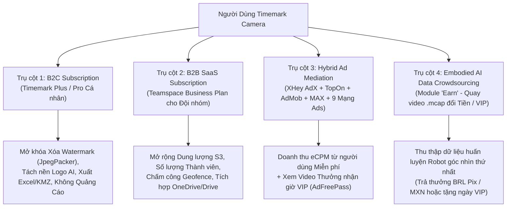
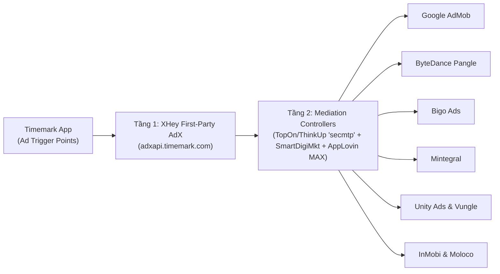

# 07. Phân Tích Chuyên Sâu Hệ Thống Payment Wall (Paywall), Quảng Cáo (Ads Mediation) & Mô Hình Kiếm Tiền (Monetization)

> **Đáp ứng Yêu cầu:** **Mục 14** (Phân tích Payment Wall, các gói thuê bao, luồng thanh toán Google Play & Stripe, kiến trúc hiển thị quảng cáo, vị trí đặt quảng cáo và danh sách toàn bộ Ad Keys).

---

## 1. Tổng Quan Mô Hình Kiếm Tiền Đa Tầng (4-Pillar Monetization Strategy)

Không giống các ứng dụng tiện ích thông thường chỉ dựa vào quảng cáo hoặc một gói VIP đơn lẻ, **Timemark** vận hành một cỗ máy kiếm tiền **4 trụ cột (Hybrid B2C + B2B + AdTech + AI Data Crowdsourcing)** cực kỳ tinh vi:

---

## 2. Phân Tích Chi Tiết Payment Wall & Hệ Thống Gói Thuê Bao (Subscriptions & In-App Purchases)

### 2.1. Kiến Trúc Màn Hình Paywall Kép (`PurchaseActivity.java` & `uz/p.java`)
Trích xuất từ `com.xhey.xcamera.ui.bill.PurchaseActivity` và trình quản lý thanh toán `sources/uz/p.java`, màn hình Paywall của Timemark được thiết kế với **2 chế độ chuyển đổi linh hoạt (Dual-Mode Paywall)**:
1. **`PAGE_STATUS_PRO` (`Timemark Plus` — Dành cho Cá nhân)**:
   - Giao diện: Nền tối sang trọng (`#0F141F`) kết hợp điểm nhấn Vàng Kim (`#FFB800` / `#F59E0B`), băng chuyền (Carousel) minh họa trực quan các tính năng cao cấp.
   - **Quyền lợi mở khóa**:
     - **Remove Watermark**: Khôi phục ảnh gốc không dấu từ ảnh đã chụp (thông qua `JpegPacker` + API `workgroup/photo/watermark/remove/check`).
     - **AI Logo Cutout**: Tự động tách nền logo công ty không giới hạn (`logo/cutout`).
     - **Advanced Export**: Xuất báo cáo ảnh ra file **Excel (`.xlsx`)**, **PDF tùy chỉnh**, và **KMZ (Google Earth)** không dính nhãn quảng cáo.
     - **Custom Watermark & Anti-Fake Lock**: Tùy biến toàn bộ trường thông tin và ẩn biểu tượng thương hiệu Timemark.
     - **100% Ad-Free**: Tắt toàn bộ quảng cáo trong ứng dụng.
2. **`PAGE_STATUS_BUSINESS` (`Teamspace Business Plan` — Dành cho Doanh nghiệp / Đội nhóm)**:
   - Giao diện: Chuyển sang tông Xanh Doanh Nghiệp (`#2563EB` / `#1D4ED8`), tập trung vào quản lý nhân sự và lưu trữ đám mây.
   - **Quyền lợi mở khóa**:
     - Tăng giới hạn số lượng thành viên trong nhóm (`business/subscription/member/quota`).
     - Mở rộng dung lượng lưu trữ đám mây AWS S3 cho ảnh/video công trường (`storage_limit_bytes` trong `team_space_entry`).
     - Mở khóa **Chấm công hàng rào địa lý (Geofence Timeclock)** (`app/group/timeclock/geofence/*`) và xuất bảng công tự động.
     - Tự động đồng bộ ảnh theo thời gian thực sang **Microsoft OneDrive / Google Drive**.

### 2.2. Danh Sách Mã Gói Cước (Product IDs / SKUs) Trên Google Play & Stripe
Trích xuất từ `sources/uz/p.java` (`BillingHelper`) và `TodayApiServiceKt`:

| STT | Mã SKU (`ProductId`) | Loại (`ProductType`) | Phân khúc | Mô tả gói cước & Cơ chế hoạt động |
| :---: | :--- | :---: | :--- | :--- |
| 1 | `00000001` | `BillingClient.ProductType.SUBS` | **Timemark Plus (Hàng năm)** | Gói thuê bao tự động gia hạn theo năm (Annual Plan - thường kèm 3 hoặc 7 ngày dùng thử miễn phí `Free Trial`). |
| 2 | `0000000220240807` | `BillingClient.ProductType.SUBS` | **Timemark Plus (Ưu đãi đặc biệt)** | Gói thuê bao năm khuyến mãi giảm giá (Discounted Annual Subscription) hiển thị khi người dùng định đóng Paywall. |
| 3 | `pro-monthly-non-stripe` | `BillingClient.ProductType.SUBS` | **Timemark Plus (Hàng tháng)** | Gói thuê bao tự động gia hạn theo tháng qua Google Play Billing. |
| 4 | `plus_1year_onetime` | `BillingClient.ProductType.INAPP` | **Timemark Plus (Mua đứt 1 năm)** | Gói thanh toán 1 lần không tự động gia hạn (One-time Purchase 1 Year) dành cho thị trường người dùng ngại thẻ tín dụng gia hạn tự động. |
| 5 | *Dynamic Business SKUs* (`business/subscription/gp/goods/list`) | `BillingClient.ProductType.SUBS` | **Teamspace Business (Google Play)** | Các gói thuê bao nhóm theo số ghế (Seats) được tải động từ máy chủ. |
| 6 | *Stripe Web Checkout* (`app/plan/shortLink/create`) | **Stripe Web (`?plan-id=`)** | **Teamspace Business (Web Checkout)** | Cho phép chủ doanh nghiệp mở trình duyệt thanh toán qua **Stripe** (`https://teamspace.timemark.com?...&plan-id=...`) để xuất hóa đơn thuế doanh nghiệp và giảm phí hoa hồng nền tảng. |

### 2.3. Chiến Thuật Tối Ưu Tỷ Lệ Chuyển Đổi Trên Paywall (CRO Mechanics)
Mã nguồn `PurchaseActivity.java` và `c40/h.java` hé lộ **3 kỹ thuật tăng trưởng doanh thu rất thông minh**:
1. **Khảo sát giữ chân khi thoát Paywall (`PaywallExitSurvey` — `c40.h`)**:
   - Khi người dùng bấm nút `X` để đóng màn hình `PurchaseActivity` mà chưa mua, ứng dụng bật một hộp thoại khảo sát nhanh hỏi lý do (*"Giá quá cao"*, *"Chỉ cần dùng 1 lần"*, *"Chưa có phương thức thanh toán phù hợp"*) và gửi về API `user/Retention/feekback`, đồng thời tung ra gói giảm giá đặc biệt (`0000000220240807`) hoặc gói mua lẻ 1 tháng.
2. **Đếm số lần dùng thử tính năng VIP (`app/user/event/count`)**:
   - Thay vì khóa cứng ngay từ đầu, ứng dụng cho phép người dùng trải nghiệm thử một số mẫu Watermark VIP hoặc xuất báo cáo vài lần đầu; mỗi lần dùng sẽ gọi `app/user/event/add`. Khi chạm ngưỡng giới hạn (`app/user/event/count`), Paywall mới bật lên đúng lúc người dùng đang cần tính năng đó nhất.
3. **Thẻ Miễn Quảng Cáo Tạm Thời (`AdFreePassState` — `o90/l.java`)**:
   - Người dùng chưa đủ tiền mua VIP có thể nhận `AdFreePass` (qua việc xem quảng cáo thưởng hoặc hoàn thành nhiệm vụ trong mục **Earn**). Trạng thái này được quản lý bởi `o90/l.java` với đồng hồ đếm ngược thời gian hết hạn hiển thị ngay trong trang Cài đặt.

---

## 3. Phân Tích Hệ Thống Quảng Cáo Đa Mạng (Ad Mediation Stack & Ad Keys)

### 3.1. Kiến Trúc Điều Phối Quảng Cáo 3 Lớp (3-Tier Ad Waterfall & Bidding)

1. **Tầng 1 — Máy chủ điều phối riêng (`adxapi.timemark.com/next/app/adx/global_fetch_exposure_config`)**:
   - Khi khởi động, lớp `wm.b` gọi API này để tải quy tắc hiển thị quảng cáo theo từng quốc gia và từng phân nhóm người dùng (ví dụ: không hiển thị quảng cáo trong N ngày đầu sau khi cài đặt để giữ chân người dùng mới).
2. **Tầng 2 — Bộ điều phối Mediation (`com.secmtp.sdk` TopOn/ThinkUp + `com.smartdigimkt` + `AppLovin MAX`)**:
   - Chạy đấu giá thời gian thực (In-App Header Bidding) kết hợp thác nước (Waterfall) giữa 11 mạng quảng cáo quốc tế.
3. **Các Vị Trí Đặt Quảng Cáo (Ad Placements) Trong Ứng Dụng**:
   - **Splash / App Open Ad**: Hiển thị khi mở ứng dụng từ trạng thái lạnh hoặc quay lại từ nền (`AppOpenAd`).
   - **Local Preview / After-Save Interstitial**: Quảng cáo xen kẽ hoặc Native hiển thị sau khi người dùng xem ảnh vừa chụp hoặc xuất báo cáo PDF/ZIP miễn phí.
   - **Watermark Store Native Banner**: Quảng cáo tự nhiên xen giữa danh sách kho mẫu Watermark.
   - **Rewarded Video Ad**: Xem video 15–30 giây để mở khóa tạm thời mẫu Watermark cao cấp, xóa Watermark lẻ 1 lần hoặc nhận `AdFreePass`.

### 3.2. Danh Sách Khóa Quảng Cáo & Cấu Hình Ad SDKs Trong Mã Nguồn

| STT | Mạng Quảng Cáo / Mediation | Khóa Định Danh / Cấu Hình Trong APK | Vị Trí Khai Báo |
| :---: | :--- | :--- | :--- |
| 1 | **Google AdMob** | App ID: `ca-app-pub-7127323313882922~8931907491` | `AndroidManifest.xml` (`com.google.android.gms.ads.APPLICATION_ID`) |
| 2 | **AppLovin MAX** | SDK Key: `83X25u7v9w1x3y5z7A9B1C3D5E7F9G1H3I5J7K9L1M3N5O7P9Q1R3S5T7U9V1W3X5Y7Z9a1b3c5d7e9f1g3h5i` | `AndroidManifest.xml` (`applovin.sdk.key`) |
| 3 | **XHey AdX (First-Party)** | Base URL: `https://adxapi.timemark.com/next/` Config API: `app/adx/global_fetch_exposure_config` | `sources/wm/b.java`, `TodayApiServiceKt.java` |
| 4 | **TopOn / ThinkUp (`secmtp`)** | Providers: `com.secmtp.sdk.core.base.TProvider` Dynamic Placement IDs tải từ `app/adx/global_fetch_exposure_config` | `AndroidManifest.xml`, `com/xhey/ad/*` |
| 5 | **SmartDigiMkt** | SDK Namespace: `com.smartdigimkt.sdk.*` | `AndroidManifest.xml`, `sources/com/smartdigimkt/*` |
| 6 | **ByteDance Pangle** | Provider: `com.bytedance.sdk.openadsdk.multipro.TTMultiProvider` | `AndroidManifest.xml` |
| 7 | **Bigo Ads** | Provider: `sg.bigo.ads.controller.provider.BigoAdsProvider` | `AndroidManifest.xml` |
| 8 | **Mintegral (Mobvista)** | Activities: `com.mbridge.msdk.activity.MBCommonActivity`, `MBRewardVideoActivity` | `AndroidManifest.xml` |
| 9 | **Liftoff (Vungle)** | Provider: `com.vungle.ads.internal.util.VungleProvider` | `AndroidManifest.xml` |
| 10 | **Unity Ads** | Activities: `com.unity3d.services.ads.adunit.AdUnitActivity` | `AndroidManifest.xml` |
| 11 | **InMobi** | Activity: `com.inmobi.ads.rendering.InMobiAdActivity` | `AndroidManifest.xml` |
| 12 | **Moloco** | Activity: `com.moloco.sdk.xenoss.sdkdevkit.android.adrenderer.internal.ui.MolocoAdActivity` | `AndroidManifest.xml` |
| 13 | **Facebook Audience / App Events** | App ID: `1184729568914023` | `res/values/strings.xml`, `AndroidManifest.xml` |

---

## 4. Mô Hình Kiếm Tiền Độc Đáo: Thu Thập Dữ Liệu Huấn Luyện Robot ("Earn" / Embodied AI)

Một phát hiện cực kỳ thú vị trong phiên bản `v10.0.281` là phân hệ **`com.xhey.embodied.*` & `com.xhey.xcamera.earn.*`**:
- **Bối cảnh kinh doanh**: Các công ty phát triển Robot hình người (Humanoid Robotics / Embodied AI) trên thế giới đang rất khát dữ liệu video góc nhìn thứ nhất (Egocentric Video) ghi lại cảnh bàn tay con người thao tác các công việc hàng ngày kèm thông số cảm biến chuyển động.
- **Cách Timemark biến người dùng thành mạng lưới thu thập dữ liệu AI**:
  1. Người dùng vào mục **"Earn" (`EarnHomeActivity`)**, chọn một nhiệm vụ trong `app/reward/video/task/list` (ví dụ: quay cảnh phân loại hàng hóa, sửa chữa dụng cụ, nấu ăn).
  2. Màn hình `ArCollectActivity` bật Camera kết hợp **AI nhận diện 21 khớp bàn tay (`HandLandmark`)** vẽ khung xương bàn tay trực tiếp lên màn hình (`HandOverlayView`), đồng thời ghi lại **4 cảm biến IMU (Gia tốc, Con quay hồi chuyển, Trọng lực, Vector quay)** và âm thanh 48kHz đóng gói vào định dạng chuẩn Robot **`.mcap`** (`McapCollector`).
  3. Sau khi tệp `.mcap` được tải lên AWS S3 và duyệt qua `app/reward/video/submit`, người dùng nhận được:
     - **Tiền mặt**: Rút trực tiếp về ngân hàng tại **Brazil (qua cổng Pix, đơn vị `BRL`, tối thiểu 30 BRL `minAmountFen=3000`, tối đa 5,000 BRL)** hoặc tại **Mexico (đơn vị `MXN`, tối thiểu 100 MXN `minAmountFen=10000`)**.
     - **Hoặc đổi lấy ngày sử dụng VIP `Timemark Plus` miễn phí** (`key_earn_vip_status`).
- **Giá trị chiến lược**: Mô hình này giúp nhà phát triển vừa thu được nguồn dữ liệu huấn luyện Robot trị giá hàng triệu USD từ hàng triệu công nhân thực địa, vừa giữ chân người dùng không có thẻ thanh toán quốc tế bằng cách cho họ "làm nhiệm vụ đổi VIP".
