# 08. Sơ Đồ Luồng Màn Hình (Screen Navigation Flow) & Phân Cấp Menu / Tab Toàn Ứng Dụng

> **Đáp ứng Yêu cầu:** **Mục 15** (Phân tích luồng đi của các màn hình - Screen Flow) & **Mục 16** (Phân tích cấu trúc Menu, Tab từ cha đến con trong toàn bộ ứng dụng).

---

## 1. Sơ Đồ Tổng Quan Luồng Điều Hướng Toàn Ứng Dụng (Master Screen Navigation Flow — Mục 15)

Ứng dụng **Timemark** lấy màn hình **Camera Thời Gian Thực (`PreviewActivity`)** làm trung tâm (Camera-First Architecture). Từ màn hình Camera trung tâm này, người dùng rẽ nhánh sang **5 luồng nghiệp vụ chính**:

```mermaid
flowchart TB
    Start(["Khởi động App<br/>(Splash / Onboarding)"]) --> Perm{"Kiểm tra Quyền<br/>Camera & GPS"}
    Perm -- "Lần đầu cài đặt" --> Guide["Onboarding Chọn Ngành Nghề<br/>(Xây dựng, Giao hàng, An ninh...)"]
    Perm -- "Đã cấp quyền" --> Cam["MÀN HÌNH TRUNG TÂM:<br/>PreviewActivity (Camera & Watermark Live)"]
    Guide --> Cam

    subgraph Branch1["Nhánh 1: Kho Mẫu & Tuỳ Biến Watermark"]
        Cam -->|"Chạm nút 'Watermark' / Chạm lên khung dấu"| WMStore["Watermark Store BottomSheet<br/>(Kho Mẫu PGC / UGC / Nhóm)"]
        WMStore -->|"Chọn chỉnh sửa mẫu"| WMEdit["WatermarkEditFragment<br/>(Bật/tắt trường, Đổi màu, Thêm dòng)"]
        WMEdit -->|"Chèn Logo"| LogoSearch["LogoSearchActivity & AI Cutout<br/>(Tìm & Tách nền Logo AI)"]
        WMEdit -->|"Sửa Vị trí / Bản đồ"| LocPick["LocationPicker / Custom POI<br/>(Chọn địa điểm GPS / Sửa tọa độ)"]
        WMEdit -->|"Thêm Mã QR / La bàn"| QREdit["QRCode & Azimuth Compass Config"]
    end

    subgraph Branch2["Nhánh 2: Thư Viện Ảnh, Xác Thực & Xuất Báo Cáo"]
        Cam -->|"Chạm Thumbnail Ảnh góc trái"| LocalGallery["LocalPreviewActivity<br/>(Thư viện ảnh/video nội bộ)"]
        LocalGallery -->|"Chọn nhiều ảnh -> Export"| ExportHub["WorkReport / Batch Export Hub<br/>(Xuất PDF, Excel, KMZ, Ghép ảnh, ZIP)"]
        LocalGallery -->|"Bấm 'Remove Watermark'"| UnpackFlow["JpegPacker Unpack<br/>(Kiểm tra VIP -> Khôi phục ảnh gốc)"]
        LocalGallery -->|"Kiểm tra Mã chống giả"| VerifyRN["VerifyAuthActivity (React Native)<br/>& PhotoVerifyActivity (Giám định ảnh thật/giả)"]
    end

    subgraph Branch3["Nhánh 3: Hệ Sinh Thái Teamspace SaaS (Nhóm Làm Việc)"]
        Cam -->|"Chuyển Tab 'Teamspace' / Icon Nhóm"| TeamHome["TeamSpaceHomeParentActivity<br/>(Không gian làm việc nhóm)"]
        TeamHome --> TabFeed["Tab 1: Photo Feed & Search<br/>(Dòng thời gian ảnh công trường)"]
        TeamHome --> TabProj["Tab 2: Projects & Photo Map<br/>(Quản lý Dự án, Bản đồ Cụm ảnh, Tài liệu)"]
        TeamHome --> TabAttend["Tab 3: Attendance & Checklist<br/>(Chấm công Geofence, Nghiệm thu, Tuần tra)"]
        TeamHome --> TabManage["Tab 4: Team Settings & Members<br/>(Phân quyền, Mời QR/Email, Đồng bộ OneDrive)"]
    end

    subgraph Branch4["Nhánh 4: Kiếm Tiền Embodied AI ('Earn' Module)"]
        Cam -->|"Biểu tượng 'Earn' / Trung tâm Cá nhân"| EarnHome["EarnHomeActivity<br/>(Danh sách nhiệm vụ & Số dư Ví)"]
        EarnHome -->|"Chọn nhiệm vụ"| TaskDetail["EarnTaskDetailFragment<br/>(Xem video mẫu & Yêu cầu góc quay)"]
        TaskDetail -->|"Bắt đầu quay"| ArCollect["ArCollectActivity<br/>(Quay HEVC + 21 Hand Landmarks + IMU -> .mcap)"]
        ArCollect -->|"Kiểm tra & Nộp"| McapPlay["McapPlayerActivity -> Upload AWS S3"]
        EarnHome -->|"Rút tiền thưởng"| Withdraw["WithdrawActivity<br/>(Rút tiền Pix BRL / SPEI MXN / Đổi VIP)"]
    end

    subgraph Branch5["Nhánh 5: Cài Đặt, Tài Khoản & Paywall"]
        Cam -->|"Icon Cài đặt / Hồ sơ góc trên"| Settings["SettingActivity / Account Center"]
        Settings --> Login["LoginActivity<br/>(Google, Microsoft MSAL, Email OTP)"]
        Settings --> Paywall["PurchaseActivity (Dual-Tab Paywall)<br/>Tab 1: Timemark Plus | Tab 2: Business Plan"]
        ExportHub -.->|"Chạm tính năng VIP"| Paywall
        UnpackFlow -.->|"Chưa có VIP"| Paywall
        TabManage -.->|"Vượt hạn mức nhóm"| Paywall
    end
```



---

## 2. Cấu Trúc Phân Cấp Menu, Tab & Chức Năng Từ Cha Đến Con (Mục 16)

Dưới đây là cây phân cấp chi tiết toàn bộ hệ thống Menu, Thanh công cụ (Toolbar), Tab điều hướng và Hộp thoại (BottomSheet) từ cấp Cha (Level 1) xuống các cấp Con (Level 2, Level 3, Level 4):

### 2.1. Cây Phân Cấp Trực Quan (Parent-to-Child Hierarchy Tree)

```text
[ROOT] Ứng Dụng Timemark Camera (com.oceangalaxy.camera.new)
│
├── 1. MÀN HÌNH CAMERA TRUNG TÂM (PreviewActivity)
│   ├── 1.1. Thanh Công Cụ Phía Trên (Top Control Bar)
│   │   ├── [Nút] Flash Mode (Tắt / Bật / Tự động / Đèn pin luôn sáng)
│   │   ├── [Nút] Tỷ lệ khung hình (Aspect Ratio: 4:3, 16:9, 1:1, Full)
│   │   ├── [Nút] Độ phân giải & Chất lượng ảnh (HD / Full HD / 4K / Tiết kiệm dung lượng lưu trữ)
│   │   ├── [Nút] Bộ lọc & Làm đẹp (Filter & SenseTime Beauty / Chụp đêm ZeroDCE AI)
│   │   ├── [Nút] Đổi Camera Trước / Sau & Chuyển ống kính Góc siêu rộng (0.5x / 1x / 2x)
│   │   └── [Nút] Menu Mở Rộng & Cài Đặt Nhanh (More / Settings)
│   │       ├── Bật/Tắt Âm thanh màn trập (Shutter Sound)
│   │       ├── Đường lưới bố cục (Grid Lines) & Cân bằng điện tử (Leveler)
│   │       ├── Hẹn giờ chụp (Timer: Off, 3s, 5s, 10s)
│   │       ├── Chống giả mạo thời gian & khóa vị trí (Anti-Tamper Verification Badge)
│   │       └── Mở Cài Đặt Hệ Thống (SettingActivity)
│   │
│   ├── 1.2. Vùng Khung Ngắm & Lớp Phủ Watermark Trực Tiếp (Live Viewfinder & Watermark Overlay)
│   │   ├── [Khung] Watermark Đang Chọn (Interactive Draggable/Clickable Overlay)
│   │   │   ├── Chạm vào Giờ/Ngày -> Xem trạng thái đồng bộ Giờ Chuẩn Thực Tế (Verified Real-Time)
│   │   │   ├── Chạm vào Địa chỉ/Tọa độ -> Mở bảng chọn Địa điểm POI / Bản đồ vệ tinh / La bàn
│   │   │   ├── Chạm vào Dòng Ghi chú -> Mở bàn phím nhập nhanh + Lịch sử câu mẫu (`recently_edited_table`)
│   │   │   └── Chạm vào Logo -> Mở trình tìm kiếm Logo & Tách nền AI (`logo/cutout`)
│   │   ├── [Khung] Bản đồ nhỏ & La bàn góc ảnh (Mini-Map & Azimuth Compass Widget)
│   │   └── [Mã] Anti-Fake Photo Code (Mã xác thực chống giả mạo in dọc viền ảnh)
│   │
│   ├── 1.3. Thanh Chuyển Đổi Chế Độ Chụp (Camera Mode Selector Tab)
│   │   ├── [Tab 1] Photo (Chụp ảnh đóng dấu tiêu chuẩn)
│   │   ├── [Tab 2] Video (Quay video đóng dấu thời gian thực + thu âm giọng nói)
│   │   ├── [Tab 3] Attendance / Check-in (Chụp ảnh chấm công đầu ca / cuối ca)
│   │   ├── [Tab 4] AI Count / Industry Mode (Đếm ống thép AI `SteelDetect`, Biển số `VLPR`, Đếm người `FaceDetect`)
│   │   └── [Tab 5] Collage / Report Puzzle (Chụp liên tiếp ghép nhiều ảnh vào 1 trang báo cáo)
│   │
│   └── 1.4. Thanh Điều Khiển Phía Dưới (Bottom Action Bar)
│       ├── [Góc Trái] Thumbnail Thư Viện Nội Bộ (`LocalPreviewActivity`)
│       ├── [Trái Giữa] Kho Mẫu Watermark (`WaterMarkStore` / `WatermarkEditFragment`)
│       ├── [Chính Giữa] Nút Bấm Máy (Shutter Button - Chụp ảnh / Quay video)
│       ├── [Phải Giữa] Chế độ Tự động Tải lên Nhóm (Auto-Sync to Teamspace Toggle)
│       └── [Góc Phải] Lối vào Không Gian Nhóm (`Teamspace`) & Kiếm Tiền (`Earn`)
│
├── 2. KHO MẪU & CHỈNH SỬA WATERMARK (Watermark Store & Editor)
│   ├── 2.1. Các Tab Danh Mục Mẫu Watermark (`cloud_category_table`)
│   │   ├── [Tab] My / Recent (Mẫu đang dùng & vừa dùng gần đây)
│   │   ├── [Tab] Team Watermarks (Mẫu bắt buộc của Công ty/Dự án)
│   │   ├── [Tab] Time & Location (Thời gian thực, Tọa độ GPS, Kinh/Vĩ độ UTM/MGRS)
│   │   ├── [Tab] Construction & Engineering (Nhật ký thi công, Nghiệm thu vật tư, Đếm thép)
│   │   ├── [Tab] Attendance & Patrol (Chấm công ca làm việc, Tuần tra bảo vệ QR)
│   │   ├── [Tab] Cleaning, Property & Logistics (Vệ sinh, Quản lý tòa nhà, Giao nhận hàng)
│   │   └── [Tab] Shared / UGC Search (Nhập mã chia sẻ mẫu hoặc tìm mẫu cộng đồng)
│   │
│   └── 2.2. Màn Hình Chỉnh Sửa Chi Tiết Mẫu (`WatermarkEditFragment`)
│       ├── [Mục] Logo Thương Hiệu (Bật/Tắt, Tải ảnh lên, Tách nền AI, Chỉnh vị trí)
│       ├── [Mục] Thời Gian & Ngày Tháng (Đổi định dạng 12h/24h, Múi giờ, Ẩn/Hiện giây)
│       ├── [Mục] Vị Trí & Bản Đồ (Độ chính xác GPS, Định dạng tọa độ DMS/Decimal, Kiểu bản đồ Vệ tinh/Đường phố)
│       ├── [Mục] Thời Tiết & Độ Cao (Nhiệt độ °C/°F, Độ ẩm, Tốc độ gió, Độ cao so với mực nước biển)
│       ├── [Mục] Các Trường Tùy Chỉnh (Custom Fields: Thêm dòng mới, Bật lịch sử nhập liệu)
│       ├── [Mục] Giao Diện & Phong Cách (`watermark/Skin/list`: Đổi màu nền, Độ trong suốt, Cỡ chữ, Font chữ)
│       └── [Nút] Chia Sẻ Mẫu Watermark (`watermark/share/public/register` -> Tạo mã Code & Link)
│
├── 3. THƯ VIỆN ẢNH NỘI BỘ & XUẤT BÁO CÁO (`LocalPreviewActivity`)
│   ├── 3.1. Bộ Lọc Xem Ảnh
│   │   ├── [Tab] Tất cả ảnh & video (Phân nhóm theo Ngày chụp `album_number_table_new`)
│   │   ├── [Tab] Lọc theo Mẫu Watermark / Dự án
│   │   └── [Công cụ] Chọn Hàng Loạt (Batch Select Mode)
│   ├── 3.2. Các Thao Tác Trên Một Bức Ảnh Đơn Lẻ
│   │   ├── [Nút] Remove Watermark (Xóa Watermark khôi phục ảnh gốc qua `JpegPacker`)
│   │   ├── [Nút] Verify Authenticity (Kiểm tra mã chống giả `PhotoCode` & Chứng nhận ảnh thật)
│   │   ├── [Nút] Edit Note / Re-apply Watermark (Sửa ghi chú hoặc đóng dấu lại cho ảnh trong máy)
│   │   └── [Nút] Upload to Teamspace (Đẩy ảnh lên dự án của nhóm)
│   └── 3.3. Trung Tâm Xuất Báo Cáo Hàng Loạt (Batch Export Hub)
│       ├── [Xuất 1] PDF Work Report (1 ảnh/trang, 2 ảnh/trang, 4 ảnh/trang, 6 ảnh/trang, kèm bìa dự án)
│       ├── [Xuất 2] Excel Spreadsheet (`.xlsx` dùng Apache POI: tự động chia cột Ảnh, Giờ, Tọa độ, Ghi chú)
│       ├── [Xuất 3] KMZ Map File (Tệp bản đồ mở trực tiếp trên Google Earth Desktop/Web kèm ảnh tại tọa độ)
│       ├── [Xuất 4] Photo Collage / Before-After (Ghép ảnh Trước - Sau khi thi công/vệ sinh)
│       └── [Xuất 5] ZIP Archive / Share Link (Nén toàn bộ ảnh hoặc tạo liên kết Web chia sẻ nhanh)
│
├── 4. HỆ SINH THÁI TEAMSPACE SaaS (`TeamSpaceHomeParentActivity`)
│   ├── 4.1. Thanh Chuyển Đổi Nhóm (Team Switcher Header)
│   │   ├── Chọn Nhóm làm việc hiện tại / Tạo Nhóm mới (`app/group/create`)
│   │   ├── Tham gia Nhóm bằng Mã / Link mời (`app/group/join`)
│   │   └── Thông báo Nhóm (`app/workgroup/notification/list`)
│   ├── 4.2. [Tab 1] Photos (Dòng thời gian Ảnh & Video Nhóm)
│   │   ├── Tìm kiếm đa chiều (Theo chữ OCR trên ảnh, Ghi chú, Thành viên, Ngày, Dự án)
│   │   ├── Chế độ xem Danh sách (List) / Lưới (Grid) / Bản đồ Cụm ảnh (`Photo Map`)
│   │   └── Xuất báo cáo đám mây (`app/photo/export/task/create`)
│   ├── 4.3. [Tab 2] Projects (Quản lý Công trình / Dự án)
│   │   ├── Danh sách Dự án (`app/group/project/list`) & Thống kê tiến độ
│   │   ├── Thiết lập bán kính GPS tự động nhận diện Dự án
│   │   ├── Kho Tài liệu Dự án (`app/project/file/*`: Bản vẽ, Hợp đồng, PDF)
│   │   └── Mẫu Watermark riêng của từng Dự án
│   ├── 4.4. [Tab 3] Attendance & Checklist (Chấm công & Nghiệm thu)
│   │   ├── Bấm giờ Vào ca / Tan ca (`app/attendance/punch`)
│   │   ├── Thiết lập điểm chấm công Geofence (`app/group/timeclock/geofence/*`)
│   │   ├── Danh mục Kiểm tra hiện trường (`app/checklist/*`)
│   │   └── Xuất bảng công tháng ra Excel (`app/attendance/export`)
│   └── 4.5. [Tab 4] Members & Settings (Quản trị Nhóm & Tích hợp)
│       ├── Quản lý Thành viên & Phân quyền (`Owner`, `Admin`, `Member`, `Guest`)
│       ├── Mời thành viên qua Email / QR Code / WhatsApp / Link
│       ├── Tích hợp tự động đồng bộ sang Google Drive / Microsoft OneDrive (`web/teamspace/app/integration/*`)
│       └── Quản lý Gói cước Doanh nghiệp (`Teamspace Business Plan`)
│
├── 5. MODULE KIẾM TIỀN EMBODIED AI ("EARN" — `EarnHomeActivity`)
│   ├── 5.1. Bảng Điều Khiển Ví & Phần Thưởng
│   │   ├── Hiển thị Số dư tiền thưởng (`BRL` / `MXN` / `USD`) & Ngày VIP tích lũy
│   │   └── Lịch sử rút tiền & Cài đặt tài khoản nhận tiền (`Pix` / Ngân hàng)
│   ├── 5.2. Danh Sách Nhiệm Vụ Quay Video (`Task Hall`)
│   │   ├── Xem hướng dẫn nhiệm vụ & Video mẫu (`EarnTaskDetailFragment`)
│   │   └── Màn hình Quay Thu Thập Cảm Biến (`ArCollectActivity` -> Xuất file `.mcap`)
│   └── 5.3. Lịch Sử Bài Nộp (`My Submissions`)
│       └── Trạng thái Đang tải lên S3 / Đang chấm điểm AI / Đã duyệt trả thưởng / Cần quay lại
│
└── 6. TRUNG TÂM CÁ NHÂN, XÁC THỰC & CÀI ĐẶT (`SettingActivity`)
    ├── 6.1. Hồ Sơ Tài Khoản (`LoginActivity` / `UserProfile`)
    ├── 6.2. Thẻ Nâng Cấp VIP (`PurchaseActivity`: Timemark Plus & Teamspace Business)
    ├── 6.3. Trung Tâm Xác Thực Ảnh Chống Giả (`VerifyAuthActivity` - React Native)
    │   ├── Kiểm tra 1 bức ảnh (Single Photo Verification)
    │   └── Kiểm tra hàng loạt ảnh (Batch Photo Verification)
    └── 6.4. Cài Đặt Ứng Dụng
        ├── Độ phân giải ảnh/video & Thư mục lưu trữ
        ├── Tự động lưu thêm 1 bản ảnh gốc không dấu (Save Original Photo)
        ├── Ngôn ngữ giao diện (80+ ngôn ngữ, có Tiếng Việt)
        └── Chẩn đoán mạng (`network/benchmark`), Gửi phản hồi & Chính sách bảo mật
```

---

## 3.Bảng Ma Trận Khớp Nối Activity - Layout XML Chính Trong Mã Nguồn

| STT | Tên Class Activity / Fragment | File Layout XML tương ứng (`decompiled/resources/res/layout/`) | Vai trò trong luồng điều hướng |
| :---: | :--- | :--- | :--- |
| 1 | `com.xhey.xcamera.ui.camera.picNew.PreviewActivity` | `activity_preview.xml`, `fragment_preview_new.xml` | Màn hình Camera trung tâm của ứng dụng. |
| 2 | `com.xhey.xcamera.ui.watermark.WatermarkEditFragment` | `fragment_watermark_edit_new.xml`, `layout_watermark_store.xml` | Kho mẫu và màn hình chỉnh sửa từng dòng của Watermark. |
| 3 | `com.xhey.xcamera.ui.localpreview.LocalPreviewActivity` | `activity_local_preview.xml`, `fragment_local_preview.xml` | Thư viện xem lại ảnh/video đã chụp và thanh công cụ xuất báo cáo. |
| 4 | `com.xhey.xcamera.teamspace.ui.TeamSpaceHomeParentActivity` | `activity_team_space_home_parent.xml`, `fragment_team_space_home.xml` | Khung màn hình chính của hệ sinh thái làm việc nhóm Teamspace. |
| 5 | `com.xhey.xcamera.ui.bill.PurchaseActivity` | `activity_purchase_new.xml`, `fragment_purchase_pro.xml` | Màn hình Paywall kép (Timemark Plus & Teamspace Business). |
| 6 | `com.xhey.xcamera.rn.verify.VerifyAuthActivity` | React Native `assets/verify_auth.android.jsbundle` | Trung tâm giám định ảnh thật/giả bằng OCR và Anti-Fake Code. |
| 7 | `com.xhey.xcamera.earn.EarnHomeActivity` & `ArCollectActivity` | `activity_earn_home.xml`, `activity_ar_collect.xml` | Trung tâm nhiệm vụ kiếm tiền và màn hình quay video Robot `.mcap`. |
| 8 | `com.xhey.xcamera.ui.setting.SettingActivity` | `activity_setting_new.xml` | Màn hình cài đặt tổng hợp, quản lý tài khoản và gói thuê bao. |
